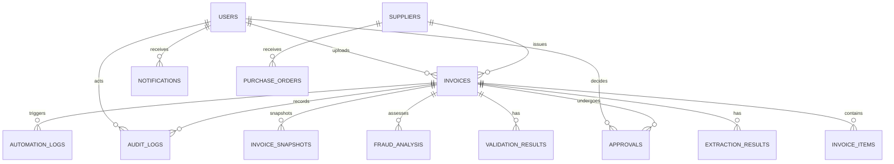

# InvoiceGuard AI - Database Architecture & Schema

The relational schema is built with SQLAlchemy and supports both SQLite (local development) and PostgreSQL (enterprise production).

## Relational Tables

### 1. `users`
- `id`: Integer (PK, autoincrement)
- `name`: String(100)
- `email`: String(150), Unique, Indexed
- `password_hash`: String(255)
- `role`: String(50) — `admin`, `manager`, `employee`
- `created_at`: DateTime

### 2. `suppliers`
- `id`: Integer (PK)
- `supplier_name`: String(200), Indexed
- `gstin`: String(50), Unique, Indexed (15-character statutory format)
- `address`: Text
- `contact_details`: String(200)
- `created_at`: DateTime

### 3. `purchase_orders`
- `id`: Integer (PK)
- `po_number`: String(100), Unique, Indexed
- `supplier_id`: Integer (FK -> suppliers.id)
- `expected_amount`: Float
- `status`: String(50) — `OPEN`, `FULFILLED`, `CANCELLED`
- `created_at`: DateTime

### 4. `invoices`
- `id`: String(50) (PK, e.g. `INV-1001`)
- `invoice_number`: String(100), Indexed
- `supplier_id`: Integer (FK -> suppliers.id, Nullable)
- `invoice_date`: String(50)
- `due_date`: String(50)
- `total_amount`: Float
- `file_path`: String(500)
- `file_name`: String(255)
- `file_type`: String(50)
- `processing_status`: String(50) — `UPLOADED`, `PROCESSING`, `COMPLETED`, `FAILED`, `MANUAL_INVESTIGATION`
- `validation_status`: String(50) — `PENDING`, `PASSED`, `WARNING`, `FAILED`
- `fraud_status`: String(50) — `PENDING`, `LOW`, `MEDIUM`, `HIGH`
- `approval_status`: String(50) — `PENDING`, `APPROVED`, `REJECTED`, `ESCALATED`
- `uploaded_by`: Integer (FK -> users.id, Nullable)
- `created_at`: DateTime
- `updated_at`: DateTime

### 5. `invoice_items`
- `id`: Integer (PK)
- `invoice_id`: String(50) (FK -> invoices.id)
- `description`: String(255)
- `quantity`: Float
- `unit_price`: Float
- `tax`: Float
- `total`: Float

### 6. `extraction_results`
- `id`: Integer (PK)
- `invoice_id`: String(50) (FK -> invoices.id)
- `extracted_data`: JSON
- `confidence_scores`: JSON
- `ocr_text`: Text
- `attempt_number`: Integer (Tracks up to 3 re-extractions)
- `status`: String(50)
- `created_at`: DateTime

### 7. `validation_results`
- `id`: Integer (PK)
- `invoice_id`: String(50) (FK -> invoices.id)
- `validation_status`: String(50)
- `validation_details`: JSON
- `created_at`: DateTime

### 8. `fraud_analysis`
- `id`: Integer (PK)
- `invoice_id`: String(50) (FK -> invoices.id)
- `risk_score`: Float (0 to 100)
- `risk_category`: String(50) — `LOW`, `MEDIUM`, `HIGH`
- `detected_issues`: JSON
- `explanation`: Text
- `created_at`: DateTime

### 9. `approvals`
- `id`: Integer (PK)
- `invoice_id`: String(50) (FK -> invoices.id)
- `manager_id`: Integer (FK -> users.id)
- `decision`: String(50) — `APPROVED`, `REJECTED`, `ESCALATED`
- `reason`: Text
- `created_at`: DateTime

### 10. `audit_logs`
- `id`: Integer (PK)
- `invoice_id`: String(50) (FK -> invoices.id, Nullable)
- `user_id`: Integer (FK -> users.id, Nullable)
- `action`: String(100)
- `details`: JSON
- `record_hash`: String(100) (Chained SHA-256 for immutability)
- `timestamp`: DateTime

### 11. `invoice_snapshots`
- `id`: Integer (PK)
- `invoice_id`: String(50) (FK -> invoices.id)
- `version`: Integer
- `snapshot_json`: JSON
- `snapshot_hash`: String(100)
- `created_at`: DateTime

### 12. `automation_logs`
- `id`: Integer (PK)
- `invoice_id`: String(50) (FK -> invoices.id, Nullable)
- `workflow_name`: String(100)
- `execution_status`: String(50)
- `execution_details`: JSON
- `created_at`: DateTime

### 13. `notifications`
- `id`: Integer (PK)
- `user_id`: Integer (FK -> users.id, Nullable)
- `invoice_id`: String(50)
- `message`: Text
- `notification_type`: String(50)
- `read_status`: Boolean
- `created_at`: DateTime
